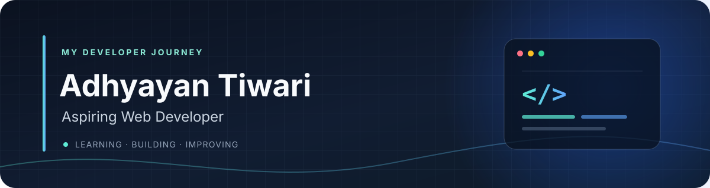

  

---

## About me

I'm Adhyayan, a student starting my journey in web development. I'm learning how ideas become useful web experiences and exploring AI along the way.

- 🎯 **Focus:** Frontend web development
- 🌱 **Learning:** HTML, CSS, JavaScript, Python, and AI
- 🧭 **Approach:** Build a strong foundation, then turn what I learn into small projects

## My learning stack

### Web foundations

  

### Programming & exploration

 

## Current focus

| Track | Learning now |
| --- | --- |
| Web | HTML & CSS foundations · JavaScript fundamentals |
| Programming | Python basics |
| Exploration | AI concepts |

## Projects

My project showcase is coming soon. I'm building my skills now and will add projects here as I create and publish them.

## Connect

  

Learning today, building tomorrow.

